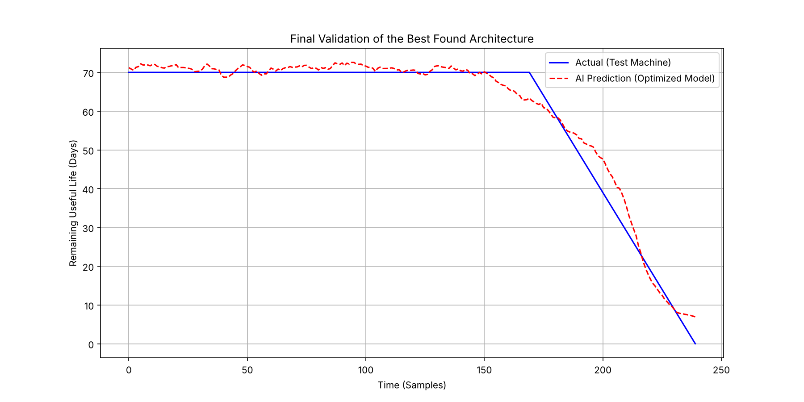

# Remaining Useful Life (RUL) Prediction with an LSTM

An LSTM network estimates the remaining useful life of a rotating machine from a vibration signal, for predictive-maintenance scheduling. Network hyper-parameters are chosen by **Bayesian optimisation** (Keras Tuner).

> **Note on the data.** The vibration signals are **simulated**, not measured. A healthy baseline with Gaussian noise is followed by exponential growth after a fault-onset day. The purpose of the project is the modelling and evaluation pipeline, not a validated industrial result.

## Degradation model
```
vibration(t) = 10 + N(0, sigma)                      for t <= t_fault
vibration(t) = 10 + N(0, sigma) + exp((t - t_fault)/k)   for t >  t_fault
RUL_clipped  = min(RUL, 70)
```
RUL is clipped because the remaining life of a healthy machine is not observable from its vibration signal. Without clipping, the network is asked to learn a label that carries no information.

## Evaluation protocol
Three independent simulated machines are used, so no test data influences the model:

| Machine | Parameters | Used for |
|---|---|---|
| Train | 200 days, fault at 120, sigma 0.4, k 20 | training |
| Validation | 230 days, fault at 140, sigma 0.6, k 22 | hyper-parameter search + early stopping |
| Test | 250 days, fault at 160, sigma 0.8, k 25 | final evaluation only |

## Results (seed 42)
| Metric | Value |
|---|---|
| Test MAE, all samples | **2.14 days** |
| Test MAE, degradation phase only (RUL < 70) | **3.83 days** |
| Unseen degradation regime (k = 15, much faster than training) | **15.38 days** |

The headline figure is dominated by the long healthy phase, where the clipped label is constant and trivially predictable. The degradation-phase MAE is the number that matters for maintenance planning, and it is roughly twice as large.

The third row is the honest limitation: the model was trained on one degradation rate and does not transfer to a machine that fails much faster. Covering that would need training data spanning several degradation regimes.



## Pipeline
1. Simulate the three machines, scale with a `MinMaxScaler` fitted **on the training machine only**.
2. Build sliding windows of 10 days.
3. Bayesian hyper-parameter search (15 trials) over LSTM units, dense units, dropout and learning rate, scored on the validation machine.
4. Retrain the best architecture with early stopping, then evaluate once on the test machine.

## Run
```bash
pip install -r requirements.txt
python rul_lstm.py
```
